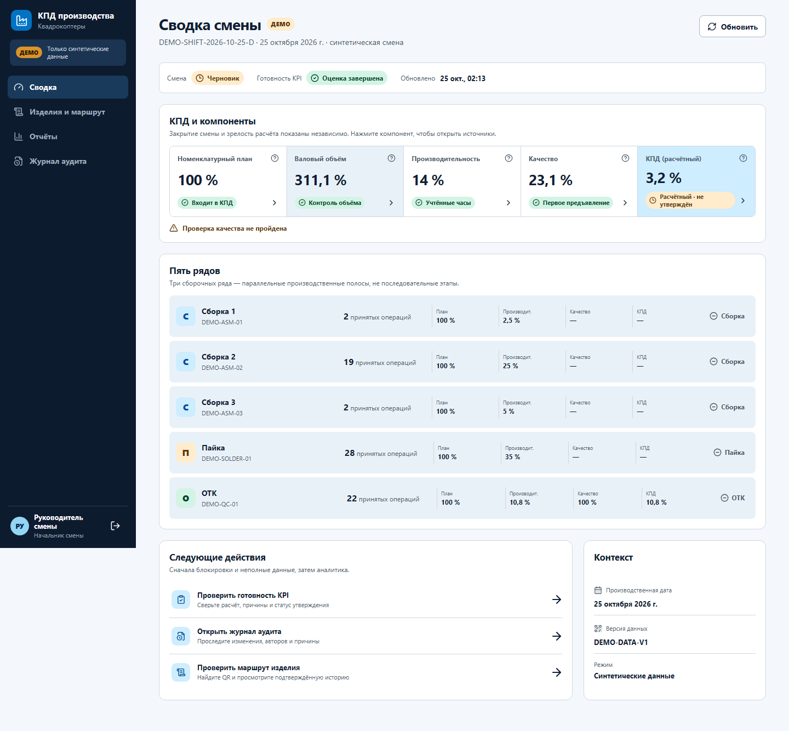

# Производственный учёт квадрокоптеров и расчёт КПД — P0-Demo

Локальное многопользовательское веб-приложение для демонстрации производственного учёта: пять рядов, сменные назначения, QR-события операций, генеалогия `компонент → WIP → финальное изделие`, ОТК, переделки и объяснимый расчёт КПД.

> Это портфолио-демо на синтетических данных, а не внедрённая заводская система. Реальные нормы, маршруты, QR, оборудование, сеть и промышленный эффект не проверялись.



## Что показывает демо

- **Сборщик и пайка:** крупный QR-ввод, назначенные ряд и операция, серверное число первичных операций, переделки отдельно, последние сканы и безопасный повтор запроса с тем же UUID.
- **ОТК:** атомарное сохранение контрольной операции и решения «Годен/Брак», обязательная DEMO-причина брака, отдельный повторный контроль и явное открытие переделки.
- **Бригадир:** только один серверно определённый ряд — сменные назначения, подтверждённые первичные операции и переделки, сохранённая история проблемных сканов.
- **Руководитель и аудитор:** пять рядов, раздельные `A_plan/P/H`, отдельная оценка решений ОТК, происхождение расчёта, зафиксированный снимок результата и CSV.
- **Технологический контур:** настраиваемые версии маршрута, типизированные QR компонентов/WIP/финальных изделий, генеалогия и история операций и изменений.

Методика — кандидат для согласования, а не OEE и не утверждённый заводской регламент. Отсутствующий или незрелый знаменатель возвращает `NULL` с причиной, а не фиктивные 0% или 100%.

## Зачем и где это применимо

Демо показывает пользу единого экземплярного учёта для трёх уровней управления. Бригадир получает состав и фактические операции своего ряда без попытки угадать присутствие по сканам; ОТК связывает решение и причину брака с конкретным изделием и отдельным циклом переделки; руководитель видит, из каких плана, норм, часов и событий получен каждый показатель. Это помогает не смешивать первичный выпуск, повторную работу и неполные данные в одной внешне убедительной цифре.

Подход потенциально применим в дискретных сборочных цехах с серийными деталями и узлами, сменными назначениями, маршрутными операциями и контрольными точками: электроника, приборостроение, малосерийная техника. Это направление адаптации, а не готовая интеграция: для другого цеха нужно отдельно обследовать маршрут, структуру QR, нормы, табель, полномочия, оборудование и правила качества.

Иллюстративные сценарии ниже показывают поведение локального P0-Demo, а не случаи реального внедрения:

- повторная отправка одного скана с тем же UUID не создаёт вторую операцию или выпуск;
- после решения ОТК «Брак» переделка открывается отдельным явным действием, а rework потребляет труд, но не становится вторым первичным выпуском;
- перевод сотрудника между рядами закрывает прежнее назначение, не меняя авторство уже выполненных операций;
- сверхплан одной позиции не закрывает дефицит другой, а производительность использует подтверждённые человеко-часы, не интервалы между сканами.

Подробный разбор исходной проблемы, действий и наблюдаемого результата для каждого примера приведён в [портфолио-кейсе](docs/portfolio-case.md).

## Быстрый запуск на Windows

Команды ниже выполняются из корня скачанного проекта. Проверенная среда: Python 3.12.2 и Node.js 20.19.0. Порт API — `8010`, UI — `5173`.

```powershell
.\start-demo.cmd
```

Первый запуск создаёт `.venv`, устанавливает зафиксированные зависимости, применяет миграции, добавляет синтетические данные только в пустую SQLite-БД и запускает backend/frontend. После проверки готовности браузер открывает:

- UI: `http://127.0.0.1:5173`
- API docs: `http://127.0.0.1:8010/docs`
- readiness: `http://127.0.0.1:8010/api/v1/health/ready`

Безопасная остановка:

```powershell
.\stop-demo.cmd
```

Скрипт остановки сверяет PID, executable, рабочую команду и время создания процесса; неизвестные процессы не останавливаются. Подробный проверенный lifecycle описан в [статусе тестирования](docs/testing-status.md).

## Демо-входы

Общий пароль: `Demo2026!`. Учётные записи предназначены только для локальных синтетических данных.

| Логин | Рабочий сценарий |
|---|---|
| `assembly1`, `assembly2`, `assembly3` | Сборка на одном из трёх рядов |
| `solder` | Пайка |
| `qc` | Простое рабочее место ОТК и повторный контроль |
| `foreman` | Сводка собственного ряда: состав, операции, проблемы, переделки |
| `auditor` | Независимая перепроверка решений ОТК |
| `planner` | План, назначения и человеко-часы |
| `supervisor` | Сводка, утверждение и зафиксированный снимок результата |
| `admin` | Расширенный DEMO-контур |

## Проверенный статус

- Backend: **76 passed**.
- Живые Playwright E2E: **16 passed, 12 намеренных пропусков по проекту/viewport, 0 failed**.
- Frontend: typecheck, production build и `npm audit --audit-level=moderate` — PASS; 0 известных npm-уязвимостей на момент проверки.
- В отдельной свежей локальной копии повторены: backend 76 passed, `npm ci`, typecheck/build и изолированный Playwright на мигрированной и заново засеянной SQLite — 16 passed, 12 intentional skips, 0 failed.
- Проверены сохранность после перезапуска, SQLite backup/restore, сценарии worker/QC/FOREMAN, повтор UUID без дубля, настраиваемые маршруты, генеалогия, снимок KPI и CSV.

Команды локальной проверки:

```powershell
.venv\Scripts\python.exe -m pytest -q
Set-Location frontend
npm run typecheck
npm run build
npm run test:e2e
```

E2E требует запущенный API на `127.0.0.1:8010`; Playwright поднимает или переиспользует Vite UI. Детали и границы доказательств: [backend/интеграционный статус](docs/testing-status.md) и [frontend E2E](frontend/docs/testing.md).

Подготовлен [GitHub Actions workflow](.github/workflows/ci.yml): ручной запуск, push в `main`/PR, backend tests, frontend typecheck/build и изолированный live E2E на мигрированной и заново засеянной SQLite. Этот путь локально воспроизведён; hosted-статус следует проверять по первому GitHub Actions run после публикации.

## Материалы портфолио

- [Короткий кейс: задача, решения, архитектура и результат](docs/portfolio-case.md)
- [Видео-демонстрация реального локального UI — 4:10, WebM](docs/assets/portfolio-demo.webm)
- [Сценарий, таймкоды и проверка видео](docs/portfolio-demo-script.md)
- [Сценарии синтетического демо](docs/demo-scenarios.md)
- [Продукт и методика](docs/01-product-and-metrics.md)
- [Архитектура и поставка](docs/02-architecture-and-delivery.md)
- [UX, QA и портфолио](docs/03-ux-quality-and-portfolio.md)
- [API-контракт](docs/04-api.md)
- [Инфографика](docs/assets/kpd-production-quadcopters.png)

Снимки живого UI: [сборка](docs/assets/mvp-assembly.png), [ОТК](docs/assets/mvp-qc.png), [бригадир](docs/assets/mvp-foreman.png), [mobile-сводка](docs/assets/mvp-dashboard-mobile.png).

## Данные, reset и backup

SQLite DEMO хранится в `data/demo.db` и переживает перезапуск. Обычный старт не очищает данные.

Явный необратимый reset относится только к synthetic demo:

```powershell
.\stop-demo.cmd
.venv\Scripts\python.exe -m app.seed --reset
.\start-demo.cmd
```

Backup можно создать при работающем API; restore выполняется после остановки:

```powershell
.venv\Scripts\python.exe -m app.backup --backup
.\stop-demo.cmd
.venv\Scripts\python.exe -m app.backup --restore backups\demo-YYYYMMDDTHHMMSSZ.db
.\start-demo.cmd
```

## Архитектурная граница и ограничения

Текущий локальный fallback — SQLite. `Dockerfile` и `compose.postgres.yml` описывают целевой PostgreSQL-контур, но Docker/psql в этой среде отсутствуют: PostgreSQL migration, locking, load и `pg_dump/pg_restore` не проверены.

Демо-логины, пароль и QR-коды публичны и синтетические. Приложение предназначено для запуска на `127.0.0.1`; не выставляйте API/UI в Интернет и не переиспользуйте демо-пароль в других системах. `.env`, локальные БД, backups, logs, traces и ключи исключены из Git.

Проверки ролей/capabilities и новая FOREMAN-сводка собственного ряда протестированы в демо. Полная изоляция объектов во всех прежних API endpoints остаётся обязательным этапом усиления защиты перед публичной демонстрацией с недоверенными пользователями или заводским пилотом.

В P0 не входят полноценная offline-очередь, MES/1С, SSO/OIDC, TLS/PKI, SIEM, HA, несколько площадок, граф ветвлений маршрутов и партийные `split/merge`. До пилота обязательны обследование реального процесса, утверждение норм и методики, проверка сканеров/сети, ИБ, PostgreSQL, нагрузка, UAT и тренировка восстановления.

## Права на использование

Открытая лицензия к этому портфолио-репозиторию не приложена. Публичная доступность исходников сама по себе не даёт разрешения на копирование, изменение или распространение. Владелец может добавить выбранную лицензию отдельным решением.
