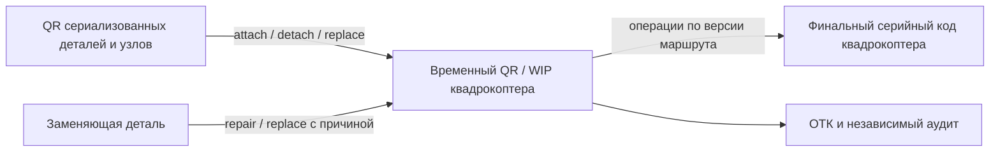
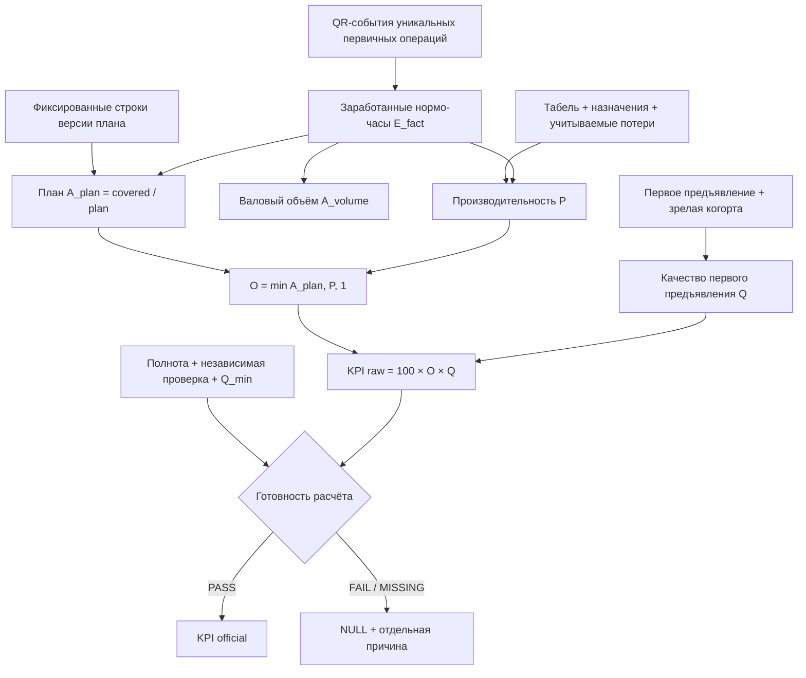

# Продукт и методика показателей

Статус: проект решения для обследования и согласования с заводом. Версия: 0.2.

## 1. Назначение и границы

Проект — многопользовательское веб-приложение производственного учёта и оценки эффективности сборки, пайки и ОТК на реальном заводе квадрокоптеров. Оно также служит портфолио-проектом по автоматизации.

Известная структура участка:

- пять конвейерных рядов: три сборочных, один пайки и один ОТК;
- за каждым рядом закреплён бригадир;
- численность и состав работников меняются по дням и в течение смены;
- у рабочего места есть отдельный компьютер или планшет и сканер;
- детали имеют собственные QR-коды; код готового квадрокоптера появляется позднее;
- операции и маршруты различаются и должны настраиваться.

Система должна отвечать раздельно:

1. Выполнен ли план по согласованному набору моделей и операций?
2. Сколько нормативной работы выполнено на фактический человеко-час?
3. Какая доля результата прошла согласованную проверку с первого предъявления?
4. Насколько надёжно ОТК выполняет контроль, не наказывая контролёра за обнаруженный производственный дефект?

Заводские нормы существуют, но ещё не предоставлены. Все формулы ниже — **предлагаемый кандидат для пилота**, а не утверждённый регламент. До загрузки и утверждения норм система может показывать натуральные факты, но не официальный КПД.

Предлагаемый показатель нельзя называть OEE. ISO 22400-2 рассматривает OEE среди KPI, относящихся к work units/оборудованию и соответствующим временным моделям; здесь оцениваются сменный план, труд людей, маршрут изделий и контроль качества.[^iso22400]

## 2. Роли и разделение обязанностей

| Роль | Задачи в MVP |
|---|---|
| Работник сборки/пайки | Войти в сессию рабочего места; сканировать объект и завершение назначенной операции; указывать разрешённый исход |
| Контролёр ОТК | Регистрировать проверку и решение по объекту; не изменять производственный факт |
| Бригадир ряда | Назначать людей на ряд/станцию/операцию; разбирать исключения; подтверждать сменный факт |
| Старший ОТК / независимый аудитор | Назначать и проводить независимую перепроверку решений; разрешать спорные случаи |
| Технолог / нормировщик | Вести модели, версии маршрутов, операции, нормы и критерии приёмки |
| Начальник смены/производства | Утверждать период, видеть отклонения по рядам, моделям, сменам и бригадам |
| Аналитик | Читать утверждённые витрины и выгружать разрешённые данные |
| Администратор | Пользователи, роли, площадки, устройства и справочники; без единоличной правки закрытого факта |

Создатель записи не утверждает её единолично. Контролёр не подтверждает результат независимого аудита собственной работы. Исправление события не удаляет оригинал, а создаёт аудируемую корректировку.

## 3. Выбранная модель MVP

### 3.1. Первичный учёт — события QR по операции и экземпляру

Ручная агрегированная строка смены не является главным источником. Основной факт — идемпотентное событие над конкретным QR-объектом:

```text
event_id, occurred_at, recorded_at
employee_id, session_id, device_id, station_id, row_id, shift_id
product_model_id, route_version_id, operation_id
entity_type, entity_id, subject_qr, wip_id, final_serial (если уже присвоен)
attempt_no, attempt_type (primary/rework), outcome
norm_version_id, correction_of_event_id, reason_code
```

Минимальное бизнес-событие регистрирует заявление: «конкретный работник в активной сессии на конкретной станции отметил завершение конкретной операции над конкретным объектом». Без машинной или независимой проверки скан не доказывает физическое завершение. Скан детали сам по себе не означает выпуск квадрокоптера.

Один и тот же сетевой повтор запроса не создаёт второй факт. Уникальность контролируется ключом `entity_type + entity_id + route_version_id + operation_id + controlled_attempt`. Повторная обработка после дефекта получает новый `attempt_no` и `attempt_type=rework`, но не становится ещё одним первичным завершением.

Для рабочего места MVP поддерживает ровно один durable pending scan с клиентским UUID, статусом отправки и повтором доставки. До серверного подтверждения следующая операция сканирования блокируется. Перезагрузка интерфейса или повторный вход не меняют авторство: pending scan остаётся связан с исходными работником, сессией и устройством и либо подтверждается сервером идемпотентно, либо разрешается через аудируемый процесс исключения.

### 3.2. Настраиваемые маршруты

Версия маршрута задаёт:

- применимую модель квадрокоптера;
- операции и допустимые переходы;
- тип входного и выходного объекта операции;
- обязательные контрольные точки;
- допустимые ряды/станции;
- момент создания временного WIP-кода и финального серийного кода.

Три сборочных ряда могут быть параллельными альтернативами, последовательными участками или выполнять разные наборы операций. До обследования нельзя рисовать маршрут, в котором один экземпляр обязательно проходит все три ряда. Маршрут описывает операции изделия; назначение ряда является ресурсным ограничением, а не идентичностью операции.

Пайка — отдельный участок и набор операций. Что именно является объектом пайки, определяется на discovery и в настройке маршрута; физический процесс заранее не выдумывается.

Для пилота рекомендуется полностью настроить один маршрут одной модели на всех реально применимых рядах, затем расширять каталог моделей.

### 3.3. Генеалогия изделия

Предлагаемая цепочка идентичности, подлежащая подтверждению на discovery:



Генеалогия MVP охватывает сериализованные компоненты/узлы и различает события `attach`, `detach`, `replace`, `rework`, `scrap`, а также связь WIP с финальным serial. Связи `компонент → WIP → финальный серийный код` хранятся с временем действия. Замена компонента закрывает прежнюю связь и добавляет новую; история не перезаписывается. Детали, узлы, WIP и готовый квадрокоптер — разные типы объектов и разные счётчики. Партийные `split/merge` остаются после MVP.

Если на раннем этапе нет WIP-кода, экземплярная связность разрывается. Допустим временный партийный режим, но показатели генеалогии, повторных попыток и точной атрибуции качества тогда помечаются как ограниченные.

GS1 различает идентификацию класса, партии и экземпляра; для GS1 экземпляр однозначно задаётся комбинацией GTIN и serial number, а не произвольным серийным номером вне его области уникальности.[^gs1] Предприятие может использовать собственную схему, но её область уникальности должна быть задана явно.

### 3.4. Сессия рабочего места и табель

Сессия связывает работника, устройство, станцию, ряд, операцию и смену. При переводе работника с ряда на ряд прежнее назначение закрывается, новое открывается с временной границей.

Скан завершения регистрирует заявление работника о завершении операции в указанное время. Без отдельной верификации он не доказывает физическое завершение и **не доказывает**, когда операция началась, что работник сразу приступил к следующему объекту, сколько длилась чистая работа, присутствовал ли он всю смену и не помогал ли другому участку. Поэтому:

- табель/фактическое присутствие ведётся отдельным источником или подтверждаемым вводом;
- распределение часов по назначениям хранится отдельно от сканов;
- межскановый интервал используется только как диагностический сигнал, не как человеко-часы или норма операции;
- состав бригады нельзя восстанавливать только по наличию сканов.

### 3.5. Персональная сводка работника за смену

Крупный счётчик на экране сканирования означает **число принятых первичных завершений операций работника за активную смену**, а не число готовых квадрокоптеров. Источник — тот же серверный журнал `OperationEvent`, из которого строится список последних событий; локальное состояние браузера не является источником счётчика.

В основной счётчик входит событие текущего пользователя и смены, только если одновременно:

- `status=ACCEPTED`, `event_type=COMPLETE`, `attempt_type=PRIMARY`;
- событие само не является корректировкой (`correction_of_id=NULL`);
- на него не ссылается другая принятая корректировка.

Идемпотентный retry и semantic duplicate не создают новую строку журнала и не увеличивают число. `NEEDS_REVIEW`, `CANCELLED`, rework и корректировки в основной счётчик не входят. Принятые `REWORK`-завершения считаются отдельно и подписываются как операции переделки; они не являются повторным первичным выпуском или готовыми квадрокоптерами.

Граница — `actor/user + shift`, а не текущая browser session, workstation или assignment. Поэтому перевод между рядами, закрытие старой рабочей сессии и открытие новой внутри той же смены не сбрасывают сводку. Разные учётные записи одного сотрудника в P0 автоматически не объединяются.

Список последних сканов использует тот же журнал и фильтр пользователя/смены, но выбирает сохранённые `event_type=COMPLETE`. Он сортируется по авторитетному `server_received_at` от новых к старым с детерминированным вторичным ключом `event_id`. Rework показывается с отдельным типом; исходное completion-событие, на которое ссылается принятая корректировка любого автора, получает эффективный статус `CORRECTED`. Сама служебная строка `event_type=CORRECTION` не выдаётся за скан. Гарантированно отклонённый запрос и локальный pending не обещаются в серверной истории, если строка `OperationEvent` для них не сохранялась. Повторная доставка того же UUID не создаёт вторую строку истории.

Если активная смена не определена или сервер не смог прочитать журнал, UI показывает отдельное состояние «смена не найдена»/ошибку, а не ноль. Ноль допустим только когда активная смена найдена и запрос достоверно подтвердил отсутствие подходящих событий.

### 3.6. Простая рабочая форма ОТК и атомарная проверка

Для контролёра одна проверка — это атомарная пара: сохранённое completion-событие контрольной операции и ровно одно связанное решение `ACCEPT/REJECT`. Предварительный скан QR, выбор кнопки в браузере или запрос без однозначного серверного подтверждения не являются проверкой и не увеличивают счётчик. Повтор доставки того же `inspection_id` и того же тела возвращает исходную пару; тот же ID с изменённым QR, решением или причиной является конфликтом, а не новой проверкой.

Рабочая форма содержит QR, выбор «Годен/Брак» и причину отклонения. Для `REJECT` причина обязательна; для `ACCEPT` причина дефекта отсутствует, чтобы устаревшее значение формы не сохранилось скрыто. Найденный дефект увеличивает число выполненных проверок так же, как принятое изделие: это результат работы контроля, а не признак плохой работы контролёра.

Счётчик «Проверено за смену» строится из сохранённых решений текущего инспектора в активной смене, связанных с действительными `ACCEPTED + COMPLETE` событиями ОТК. Первое предъявление (`PRIMARY`) и повторный контроль (`REWORK`) считаются и показываются раздельно. Решение, чьё контрольное событие погашено принятой корректировкой, не входит в эффективный счётчик, но остаётся в истории с отметкой исправления. Независимый аудит решения не добавляет ещё одну проверку ОТК и не меняет количество проверок.

Повторный контроль разрешён только для изделия, которое завершило явно открытый цикл переделки и находится в состоянии `READY_FOR_QC`. После атомарной повторной проверки соответствующий заказ переходит в `REINSPECTED` независимо от решения: этот статус означает «повторно проверено», а не «годно». Новое отклонение создаёт новое решение; открытие следующей переделки остаётся отдельным явным действием с выбором разрешённой операции. Система не должна автоматически направлять все дефекты на один зашитый шаг.

Финализация использует актуальное эффективное решение последней требуемой контрольной попытки и отсутствие открытой переделки. Ранее полученное `ACCEPT` не может замаскировать более поздний `REJECT` повторного контроля.

Демонстрационный каталог причин может использовать только нейтральные синтетические группы: «Сборка/крепление», «Пайка/соединение», «Комплектность», «Внешнее состояние», «Функциональная проверка», «Маркировка/идентификация», «Другое». Это не заводской классификатор дефектов; реальные коды, обязательность уточняющего комментария и маршруты реакции утверждаются на discovery.

### 3.7. Рабочая сводка бригадира своего ряда

Ряд бригадира определяется сервером из явного row scope роли. Для демонстрационного переходного варианта допустим fallback только на один однозначный ряд среди действующих назначений самого бригадира в активной смене. Отсутствие ряда или несколько разных рядов дают блокирующее состояние, а не доступ ко всем рядам.

«Состав ряда» строится из сменных назначений с их интервалами и статусами. Статус назначения означает «назначение действует/завершено», но не доказывает физическое присутствие, вход в приложение или нахождение у рабочего места. Действующие и завершённые сегменты различаются статусом и временем; перевод не переписывает прошлые события.

«Выполнено за смену» — число эффективных `ACCEPTED + COMPLETE + PRIMARY` событий, чей исходный `WorkSession.row_id` относится к этому ряду и смене. Корректирующие события и погашенные ими originals не входят; принятые `REWORK` считаются отдельно. Текущее назначение сотрудника не меняет ряд исторического события. Эти числа означают операции, а не готовые квадрокоптеры, присутствие людей или персональный KPI.

«Проблемные сканы» — только серверно сохранённая история: `OperationEvent` со статусом `NEEDS_REVIEW` и неизменяемые квитанции `OPERATION_SCAN_REJECTED` для однозначных terminal domain rejects после проверки авторства рабочей сессии, смены и ряда. Сетевые ошибки, локальный pending другого компьютера и неподтверждённый браузерный ввод серверу неизвестны и не должны появляться в списке. Повтор одной submission с тем же UUID не создаёт вторую проблему. Квитанция отклонения не является производственным событием, не продвигает маршрут и не увеличивает выпуск. В P0 список read-only; `allowed_actions=[]`. Честное пустое состояние: «Нет сохранённых проблемных сканов в этом ряду», а не «Все сканы успешны».

Заказ переделки относится к ряду напрямую только при точном `requested_route_step.row_id`. Для альтернативного сборочного шага `row_id=NULL` нельзя автоматически выбрать все три ряда или ряд первичного события. До явного назначения такой заказ имеет неопределённый row scope и не попадает в action list бригадира. После фактической переделки история может быть отнесена к ряду только по эффективному `ACCEPTED + COMPLETE + REWORK` событию того же изделия и запрошенного шага, созданному не раньше заказа и не погашенному корректировкой. `OPEN/READY_FOR_QC/REINSPECTED` означают соответственно открытый цикл, передачу на повторный контроль и факт повторной проверки; последний статус не означает «годно».

## 4. Объём MVP

### В MVP

- авторизация и ролевой доступ;
- все пять рядов, их станции, устройства и бригадиры;
- дневной roster, сменные назначения и переводы работников;
- одна пилотная модель с версионируемым настраиваемым маршрутом, затем расширение справочника;
- QR-события первичных операций, доработки, контроля и корректировок;
- связь QR компонентов с WIP и финальным серийным кодом в доступной части маршрута;
- сменный план по модели, операции/этапу и ряду, где это применимо;
- версии нормативных трудозатрат по модели и операции;
- ОТК и отдельная независимая перепроверка;
- состояния качества `предварительно → ожидает независимой проверки ОТК → итог подтверждён`;
- агрегированные витрины, рассчитанные из событий, с переходом к первичным фактам;
- журнал изменений, закрытие периода и контролируемая корректировка;
- исправление только по конкретному объекту/событию с причиной и аудиторским следом;
- импорт/подтверждение фактических человеко-часов, если интеграции с табелем ещё нет.

### Вне MVP

- OEE оборудования и детальная телеметрия станков;
- автоматический расчёт зарплат, премий или санкций;
- машинное зрение и предиктивная аналитика;
- автоматическая оптимизация маршрута, такта и баланса рядов;
- полная интеграция с ERP/MES/СКУД и всеми испытательными стендами;
- ручной сменный/партийный агрегат как замена экземплярным событиям;
- партийные события `split/merge`;
- статистически доказательный персональный рейтинг при недостаточной выборке;
- любые специальные лётные или иные функции квадрокоптера, не относящиеся к производственному учёту.

### Агрегированные представления и ограничения

1. **Производная витрина из QR-событий — вариант MVP.** Строка `смена × ряд × модель × операция × бригада × версия нормы` пересчитывается из первичных событий; каждый показатель раскрывается до событий.
2. **Корректировка — экземплярная.** Ошибка исправляется компенсирующим событием по конкретным `entity_type/entity_id` и операции, а не заменой итоговой суммы.
3. **Ручной сменный/партийный агрегат — перспектива вне MVP.** Он ломает генеалогию, дедупликацию и атрибуцию попыток. Если позднее потребуется аварийный режим, его нужно отдельно спроектировать; предпочтителен локальный буфер экземплярных событий с последующей синхронизацией, а не ввод общей цифры.

## 5. Базовые величины смешанного производства

Штуки разных моделей и операций нельзя безусловно складывать для оценки труда. Основная сопоставимая единица — нормо-час.

Для модели `m`, операции `o`, версии нормы `v`:

```text
s(m,o,v) = норматив первичного выполнения операции, минут
q(m,o)   = число уникальных первичных завершений операции
E        = Σ[q(m,o) × s(m,o,v)] / 60, заработанные нормо-часы
```

Уникальное первичное завершение определяется ключом `entity_type + entity_id + route_version_id + operation_id + controlled primary attempt`. Дубликаты доставки события и rework-попытки не увеличивают `q`.

В `E_fact` входят только события допустимого типа и статуса, прошедшие валидацию маршрута и не погашенные корректирующим событием. Это не превращает скан в физическое доказательство, но не позволяет технически ошибочному или отменённому событию заработать нормативный выпуск.

План и факт должны иметь одинаковый контур операций. Нельзя сравнивать план готовых квадрокоптеров с фактом отдельных деталей или норму полного маршрута с фактом одного ряда.

На уровне готовых изделий отдельно показывается количество финальных серийных кодов, достигших определённого конечного состояния. Оно не выводится суммой всех операций.

## 6. Предлагаемая методика КПД производства

### 6.1. Раздельные показатели

#### Валовый объём и выполнение номенклатурного плана

```text
Пусть `i` — фиксированная строка утверждённой версии плана
(период/смена, модель, операция и ряд, если он задан планом), а `j` — любая фактическая позиция в отчётном контуре:

E_fact         = Σ[q_fact_j × s_j] / 60
E_plan         = Σ[q_plan_i × s_i] / 60
E_plan_covered = Σ[min(q_fact_i, q_plan_i) × s_i] / 60

A_volume = E_fact / E_plan
A_plan   = E_plan_covered / E_plan
```

План задаётся на том же уровне маршрута, который оценивается. `A_volume` показывает сырой объём нормативной работы, включая валидную внеплановую позицию в выбранном контуре, и может превышать 100%. `A_plan` показывает покрытие утверждённых плановых позиций и всегда находится в диапазоне 0–100%: внеплановый объём и сверхплан одной модели, операции, смены или заданного ряда не закрывают дефицит другой позиции.

Согласованная технологическая или номенклатурная замена допускается только отдельным правилом в версии плана с явной матрицей замен и коэффициентом пересчёта. Без такого правила позиции не взаимозаменяемы.

`E_fact` учитывает завершение операции независимо от последующего решения ОТК, поэтому один дефект не уменьшает одновременно и план, и качество. Доработка не создаёт второй первичный выпуск.

В UI рядом показываются «Валовый объём (A_volume)» и «Выполнение номенклатурного плана (A_plan)». В сводный индекс входит только `A_plan`.

#### Производительность учтённого трудового ресурса

```text
H_accounted = фактические человеко-часы, включённые версией методики
ρ_target  = утверждённая целевая отдача, НЧ на человеко-час
P_raw     = E_fact / (H_accounted × ρ_target)
```

`H_accounted` берётся из табеля и временных назначений, а не из интервалов между QR-сканами. В него входят фактически потреблённые категории ресурса согласно утверждённой версии методики, включая доработку; исключения прозрачны и версионируются. До предоставления заводом `ρ_target` показатель имеет статус `N/A`. Значение `1 НЧ/чел.-ч` допустимо только в тестах с явной пометкой.

Доработка не создаёт повторный заработанный выпуск, но потребляет ресурс. Она входит в `H_accounted` и показывается отдельно:

```text
Rework_share = H_rework / H_accounted
P_direct     = E_fact / (H_primary × ρ_target)
```

`P_direct` отражает только прямое первичное время и является диагностическим показателем, а не общей эффективностью ресурса. Один дефект фиксируется как один исход качества; его дополнительные часы — отдельное фактическое последствие, не второй дефект. Возможная корреляция Q и трудовых потерь должна быть видна в расшифровке, а не скрываться исключением реально затраченных часов.

#### Качество с первого предъявления

Для созревшей когорты на утверждённой контрольной точке:

```text
E_quality_eligible = Σ[нормо-часы первичных завершений, подлежащих оценке]
E_first_pass_good  = Σ[нормо-часы объектов, принятых с первого предъявления]
Q_fpy              = E_first_pass_good / E_quality_eligible
```

Область «Качество с первого предъявления (Q)» должна быть явной: модель, версия маршрута, контрольная точка и окно созревания. Неинспектируемые операции нельзя считать автоматически качественными. До контрольного решения состояние не равно «годно». Этот показатель не равен отсутствию рекламаций.

### 6.2. Технически однозначный кандидат сводного индекса

Рекомендуемый для пилота кандидат:

```text
O = min(A_plan, P_raw, 1)
KPI_raw = 100% × O × Q_fpy

KPI_official = KPI_raw, только если:
  completeness_gate = PASS
  AND maturity_state = FINAL
  AND Q_fpy >= Q_min
  AND critical_quality_hold = FALSE
иначе KPI_official = NULL, а причина хранится отдельным статусом
```

`Q_min` и правило критического удержания — обязательные настраиваемые параметры, которые утверждает владелец процесса; численное значение сейчас не задано. Провал минимального качества не превращается в «пропущенные данные»: пользователю показываются `KPI_raw`, фактическое качество и статус `QUALITY_GATE_FAILED`, но официальный результат/бонус не присваивается.

В UI `completeness_gate` называется «Проверка готовности расчёта», чтобы не путать готовность данных с контролем качества продукта.

Свойства формулы:

- выполнение номенклатурного плана и производительность не перемножаются;
- сверхплан одной позиции не компенсирует недовыпуск другой позиции;
- высокая скорость не компенсирует невыполнение плана и наоборот;
- `O≤1`, поэтому перевыполнение не даёт бонуса внутри сводного индекса;
- качество применяется ровно один раз к первичному результату;
- `NULL` никогда не подменяется нулём;
- компоненты всегда видны рядом со сводным числом.

Простое произведение `A_volume × P_raw` запрещено: оно повторно усиливает влияние одного валового выпуска и позволяет сверхплановой позиции скрыть номенклатурный дефицит. Равенство через `E_fact/max(...)` больше не применяется, поскольку `A_plan` использует покрытый плановый объём `E_plan_covered`, а не весь `E_fact`.

Если позже потребуется премирование за перевыполнение, оно должно быть отдельной утверждённой функцией с конечным потолком и только после прохождения проверки готовности и минимального качества. В MVP сводный индекс ограничен 100%.

Это один рекомендуемый кандидат и проверяемая гипотеза, а не универсальная формула. Публикация `KPI_official` включается только после discovery, golden examples и утверждения владельцем процесса: состава часов, контуров плана, `ρ_target`, `Q_min`, окна созревания и обработки исключений.

### 6.3. Инфографика расчёта



## 7. Корректная агрегация

Для любого уровня — работник, бригада, ряд, смена, модель, участок — сначала суммируются однородные числители и знаменатели, затем вычисляется отношение:

```text
A_volume_group = ΣE_fact / ΣE_plan
A_plan_group   = ΣE_plan_covered / ΣE_plan
P_group = ΣE_fact / Σ(H_accounted × ρ_target)
Q_group = ΣE_first_pass_good / ΣE_quality_eligible
```

`E_plan_covered` сначала считается внутри каждой исходной фиксированной строки плана, и только затем суммируется. Идентичность строки сохраняется при агрегации: сверхплан другой модели, операции, смены или заданного ряда не переносится в дефицитную строку. Среднее готовых процентов запрещено, если знаменатели различаются. Если строки используют разные `ρ_target`, суммируется нормированный знаменатель каждой строки. Нельзя агрегировать области с несовместимыми контурами операций или стадиями зрелости без явного разбиения.

## 8. Человеко-часы и смены

`1 человек × 1 час = 1 человеко-час`; два работника за один календарный час дают два человеко-часа. Для коллективной операции трудоёмкость задаётся в человеко-минутах: например, два работника по 10 минут — это 20 человеко-минут, а не 10 минут нормы труда.

Минимальные категории:

- `H_primary` — первичное выполнение операции;
- `H_rework` — доработка/повтор;
- `H_waiting` — учитываемое ожидание/простой назначенного персонала;
- `H_setup` — переналадка и подготовка;
- `H_support` — помощь, обучение, обслуживание и другой непрямой труд;
- `H_unavailable` — отсутствие, регламентированный перерыв и иные исключения.

Основной знаменатель `H_accounted` — сумма категорий фактического ресурса, включённых утверждённой версией методики. В базовом кандидате он включает как минимум `H_primary + H_rework`, а также утверждённые ожидание и переналадку. Доработка и ожидание не создают заработанных нормо-часов, но потребляют труд; их исключение искусственно повышает производительность.

Исключать категорию из `H_accounted` можно только явным правилом с версией, владельцем и датой действия. Рядом показываются структура часов и причины простоя. Диагностически можно показать `P_direct=E_fact/(H_primary×ρ_target)`, но не выдавать его за общую эффективность ресурса.

Интервалы одного человека не пересекаются в взаимоисключающих категориях. Простой оборудования не вычитает время автоматически: работник мог выполнять другую работу. Смена, табель и нормируемые часы — разные сущности.

Все временные точки хранятся в UTC; отдельно фиксируются площадка, IANA-зона, локальная производственная дата и `shift_id`. PostgreSQL `timestamp with time zone` нормализует значение во внутреннее UTC и не сохраняет исходное имя зоны, поэтому зона площадки остаётся явной бизнес-настройкой.[^postgres]

Смена через полночь относится к производственной дате по утверждённому правилу, предпочтительно по дате начала смены. Закрытые факты не перепривязываются при изменении расписания.

## 9. Честная оценка ОТК

### 9.1. Что относится к ОТК

Подтверждённый дефект, найденный контролёром, снижает качество производственного процесса, но не личное качество контролёра. Доля `принято / проверено` описывает входящее качество, а не работу ОТК.

Работа ОТК оценивается по охвату, сроку, полноте записи и корректности решений на независимой перепроверке. У контроля есть два разных риска: принять несоответствующий объект и отклонить соответствующий; NIST подчёркивает различие этих ошибок и зависимость правила решения от измерительной неопределённости и бизнес-стоимости.[^nist]

### 9.2. Показатели

```text
Coverage = inspected_due / inspection_due
Timeliness = decisions_within_SLA / decisions_due

Confirmed_escape_rate = confirmed_missed_defects / independently_audited_accepts
Confirmed_false_reject_rate = overturned_rejects / independently_audited_rejects
```

Простая `Decision_accuracy = correct / audited` допустима только при сопоставимом случайном протоколе выборки либо с заранее утверждённым стратифицированным взвешиванием. Если принятые и отклонённые решения отбирались с разной вероятностью, суммарная доля искажает результат; в MVP показываются две раздельные ошибки и размеры обеих выборок.

Нельзя:

- считать найденный дефект штрафом контролёру;
- использовать количество найденных дефектов как личную эффективность;
- считать отсутствие рекламаций или аудита доказательством 100% качества;
- делить ошибки на всю непроверенную популяцию;
- публиковать персональный рейтинг при недостаточной или смещённой выборке.

Состояния контрольной когорты в UI:

1. `PROVISIONAL` — «Предварительно»; окно наблюдения ещё открыто, рядом указаны причина и время ожидаемой готовности;
2. `AWAITING_AUDIT` — «Ожидает независимой проверки ОТК»;
3. `FINAL` — «Итог подтверждён»; аудит и разбор спорных решений завершены.

Найденный ОТК дефект показывается как результат контроля/предотвращённый выход, а не штраф контролёру. Пропуск и ложное отклонение — отдельные карточки с объёмом и основой выборки.

Дефект, обнаруженный позднее на согласованной downstream-точке, относится к исходной когорте через WIP/final serial и либо создаёт новую ревизию, либо отдельный показатель поздних дефектов — правило утверждает завод.

### 9.3. Отдельный кандидат composite для ОТК

Производственный `Q_fpy` нельзя использовать как качество работы ОТК: плохой входящий поток может означать хорошую работу контролёра, который дефекты остановил. Для ряда ОТК предлагается отдельный расчёт:

```text
s_otk_i = норма контрольной операции i, человеко-минут
E_otk_fact = Σ[факт_i × s_otk_i] / 60, НЧ
E_otk_plan = Σ[план_i × s_otk_i] / 60, НЧ
E_otk_plan_covered = Σ[min(факт_i, план_i) × s_otk_i] / 60, НЧ
H_otk_accounted = фактически учтённые человеко-часы ОТК

A_otk_plan = E_otk_plan_covered / E_otk_plan
P_otk      = E_otk_fact / (H_otk_accounted × ρ_otk_target)

O_otk = min(A_otk_plan, P_otk, 1)
KPI_otk_raw = 100% × O_otk × Q_decision
```

`Q_decision` — оценка корректности решений только по независимому аудиту. Допустимые варианты после утверждения протокола:

- для сопоставимой случайной выборки решений: `correct_audited / all_audited`;
- для стратифицированной выборки с известными вероятностями включения: взвешенная оценка по стратам «принято» и «отклонено»;
- при неизвестной/смещённой выборке: `Q_decision=NULL`, `KPI_otk_raw=NULL`; показываются только раздельные `escape_rate`, `false_reject_rate` и размеры выборок.

`KPI_otk_official` требует тех же состояний полноты, финализации и утверждения методики, а также минимального объёма независимого аудита. Он не смешивается с производственным composite сборки/пайки и не использует отсутствие рекламаций как 100% корректности.

## 10. Нулевые и неполные знаменатели

| Условие | Значение | Статус |
|---|---|---|
| План 0, факт 0 | `A_volume=NULL`, `A_plan=NULL` | Нет плановой базы |
| План 0, факт >0 | `A_volume=NULL`, `A_plan=NULL` | Внеплановая работа |
| Учтённые часы 0, факт >0 | `P=NULL` | Ошибка/неполный табель |
| Факт 0, план >0 | `A_volume=0`, `A_plan=0`, `P=0` при часах >0, `Q=NULL` | Нет объекта оценки качества |
| Нет применимой утверждённой нормы | Нормо-часовые KPI `NULL` | Натуральный факт сохраняется |
| Контроль обязателен, проверено 0 | `Coverage=0`, ошибки ОТК `NULL` | Охват провален, точность неизвестна |
| Нет независимого аудита | Ошибки ОТК `NULL` | Не 0% ошибок и не 100% качества |
| Окно качества открыто | `KPI_official=NULL` | `PROVISIONAL` |
| Аудит не завершён | `KPI_official=NULL` | `AWAITING_AUDIT` |
| `Q<Q_min` | `KPI_raw` виден, official `NULL` | `QUALITY_GATE_FAILED` |
| Обязательное поле отсутствует | Сводный KPI `NULL` | `INCOMPLETE_DATA` |

Статус причины хранится отдельным кодом. Нельзя заменять `NULL` нулём при сортировке, экспорте или визуализации.

## 11. Версии маршрутов, норм и методики

У версии нормы есть модель, операция, значение в человеко-минутах, даты действия, статус `draft/approved/retired`, автор, согласовавший и документ-основание. Утверждённая версия неизменяема; исправление создаёт новую.

Каждое событие хранит применённые `route_version_id` и `norm_version_id` или воспроизводимый снимок. Расчёт хранит `methodology_version_id`, определяющий состав `H_accounted`, параметры и правила исключений. По умолчанию используется версия производственного задания/события, а не последняя текущая.

Закрытый отчёт не пересчитывается молча. Возможны:

- `simulation` по другой версии без изменения официального результата;
- официальная новая ревизия с причиной, автором, сравнением до/после и повторным утверждением.

При отсутствии нормы или пересечении интервалов утверждённых версий расчёт блокируется. Правило для WIP, пересекающего смену нормы или маршрута, определяется на discovery.

## 12. Численные приёмочные примеры

Все числа демонстрационные. В примерах `ρ_target=1 НЧ/чел.-ч`; это не заводская норма.

### 12.1. Разные модели и операции

План: 100 операций модели A по 6 человеко-минут и 50 операций модели B по 12 человеко-минут: `E_plan=20 НЧ`.

Первично завершено: 90 A и 55 B: `E_fact=20 НЧ`. Покрытие фиксированных плановых позиций: `min(90,100)×6 + min(55,50)×12 = 1 140 минут = 19 НЧ`. Учтённые часы — 20. В этом тесте вся когорта подлежит оценке, поэтому `E_quality_eligible=20 НЧ`; с первого предъявления принято 86 A и 52 B, то есть `E_first_pass_good=19 НЧ`.

Ожидается: `A_volume=20/20=100%`, `A_plan=19/20=95%`, `P=100%`, `Q=95%`, `O=95%`, `KPI_raw=90,25%`. Модель B сверх плана не закрывает дефицит модели A. Official публикуется только при пройденной проверке готовности расчёта.

### 12.2. Скорость не скрывает план

`E_plan=20`, `E_fact=18`, `E_plan_covered=18`, `H_accounted=15`, `Q=97%`.

Ожидается: `A_volume=90%`, `A_plan=90%`, `P=120%`, `O=90%`, `KPI_raw=87,3%`. Результат `A_volume×P×Q=104,76%` запрещён.

### 12.3. План не скрывает низкую производительность

`E_plan=20`, `E_fact=24`, все плановые позиции полностью покрыты, поэтому `E_plan_covered=20`; `H_accounted=30`, `Q=100%`.

Ожидается: `A_volume=120%`, `A_plan=100%`, `P=80%`, `O=80%`, итог 80%. На карточке валового объёма остаётся 120%, но бонус в composite отсутствует.

### 12.4. Доработка не является вторым выпуском, но потребляет труд

100 одинаковых первичных операций по 6 человеко-минут дают `E_fact=10 НЧ`. С первого предъявления приняты 90 объектов, десять доработаны; `H_primary=10`, `H_rework=2`, других включённых часов нет, поэтому `H_accounted=12`.

Ожидается: `E_fact=10`, не 11; `Q=90%`; основная `P=10/12=83,33%`; диагностическая `P_direct=100%`; `Rework_share=16,67%`. Десять объектов считаются дефектными один раз; два часа — не новые дефекты, а ресурсное последствие.

### 12.5. Коллективная операция

Два работника одновременно выполняли одну операцию 10 календарных минут. Ожидается фактический ресурс `20 человеко-минут`. Если утверждённая норма операции равна 18 человеко-минутам, заработано `0,3 НЧ`, а затрачено `0,333 НЧ`; календарные 10 минут нельзя напрямую подставлять в трудовой знаменатель.

### 12.6. Повторный сетевой запрос

Два события с одним идемпотентным ключом относятся к одной первичной попытке. Ожидается одно завершение. Новая попытка после ремонта с `attempt_type=rework` сохраняется, но `E_fact` первичного выпуска не увеличивает.

### 12.7. Компонент не равен готовому изделию

Отсканированы четыре компонента, связанные с одним WIP, затем присвоен один финальный serial. Ожидается: четыре события комплектования/установки по их операциям и один готовый квадрокоптер, не пять готовых изделий.

### 12.8. Правильная агрегация

Когорта 1: 9 годных с первого предъявления из 10. Когорта 2: 90 из 90. Общий результат `(9+90)/(10+90)=99%`, не среднее процентов 95%.

### 12.9. Человеко-часы и ожидание

Три работника выполняли первичные операции по 7,5 часа; один затем час дорабатывал изделие, ещё 0,5 часа утверждённо отнесено к учитываемому ожиданию. Ожидается `H_primary=22,5`, `H_rework=1`, `H_waiting=0,5`, `H_accounted=24`. Наличие сканов не меняет эти значения без изменения табеля/назначений.

### 12.10. ОТК и неравномерная выборка

Контролёр принял 92 и отклонил 8 объектов. Независимо проверены 20 принятых и все 8 отклонённых; подтверждён один пропуск и одно ложное отклонение.

Ожидается: `escape=1/20=5%`, `false_reject=1/8=12,5%`. Простая сумма `2/28` не публикуется как оценка всей работы без утверждённого протокола взвешивания. Семь подтверждённых производственных дефектов среди восьми отклонений не штрафуют контролёра; одно ложное отклонение относится к качеству решения ОТК.

### 12.10.1. Отдельный composite ОТК при корректной выборке

Для сопоставимой случайной выборки независимо проверены 100 решений, 96 корректны. `E_otk_plan=50 НЧ`, `E_otk_fact=45 НЧ`, `E_otk_plan_covered=45 НЧ`, `H_otk_accounted=40 чел.-ч`, `ρ_otk_target=1`.

Ожидается: `A_otk_plan=90%`, `P_otk=112,5%`, `O_otk=90%`, `Q_decision=96%`, `KPI_otk_raw=86,4%`. Если выборка смещена и вероятности отбора неизвестны, `Q_decision` и composite равны `NULL`, даже при тех же наблюдаемых 96 корректных решениях.

### 12.11. Нет аудита

За период нет рекламаций и независимых перепроверок. Ожидается: обе ошибки ОТК `NULL`, состояние `AWAITING_AUDIT`, а не 100% точности.

### 12.12. Нулевой или неполный знаменатель

При плане 10 НЧ, факте 0 и `H_accounted=8` ожидается `A_volume=0`, `A_plan=0`, `P=0`, `Q=NULL`, `KPI_official=NULL` с причиной отсутствия объекта оценки качества. При факте >0 и часах 0 производительность равна `NULL`, а не бесконечности.

### 12.13. Версия нормы

100 операций по закреплённой норме 6 человеко-минут дают 10 НЧ. После утверждения нормы 5 минут исторический отчёт остаётся 10 НЧ; сценарий показывает 8,33 НЧ. Тихая замена закрытого результата блокируется.

## 13. Условия утверждения методики

- обследованы реальные маршруты трёх сборочных рядов и участок пайки;
- подтверждена схема `component QR → WIP → final serial` и правила замен;
- определены единица и момент выполнения плана для каждого оцениваемого контура;
- загружены утверждённые нормы пилотной модели в человеко-минутах;
- утверждены состав `H_accounted`, источник табеля и правила переводов;
- утверждены `ρ_target`, `Q_min`, критические удержания и окно созревания;
- определены независимая выборка ОТК и минимум данных для публикации;
- примеры раздела 12 согласованы как golden examples и реализованы автоматическими тестами;
- владелец процесса подписал формулу и включение `KPI_official`.

До выполнения этих условий интерфейс показывает тестовый/предварительный статус, а не официальный рейтинг.

## 14. Discovery без блокировки проектирования

Следующие вопросы не требуют ответа прямо сейчас, но должны быть закрыты до реализации соответствующего контура:

1. Как фактически распределены операции между тремя сборочными рядами: параллельно, последовательно или смешанно?
2. Какой объект проходит пайку и как он связывается с WIP и финальным изделием?
3. На каком событии создаётся временный WIP QR и где присваивается финальный serial?
4. Какие замены компонентов допустимы, кто их подтверждает и как обрабатывается утилизация старого компонента?
5. Где хранится сменный план: по готовым изделиям, операциям, рядам или заданиям?
6. Какой источник фактического табеля доступен до интеграции со СКУД?
7. Какие категории часов включаются в `H_accounted`, включая ожидание, переналадку, помощь и обучение?
8. Какие контрольные точки определяют первое предъявление и поздний дефект?
9. Как формируется независимая выборка ОТК и каков минимальный объём?
10. Какие события допустимо вводить в резервном ручном режиме при отказе устройств?
11. Кто имеет право открыть закрытую смену и утвердить ретроспективный пересчёт?

## 15. Источники и границы применения

Источники подтверждают только узкие определения и технические ограничения; ни один из них не предписывает предложенную внутреннюю формулу КПД.

[^iso22400]: [ISO 22400-2:2014 — Key performance indicators for manufacturing operations management](https://www.iso.org/obp/ui/?_escaped_fragment_=iso%253Astd%253A54497%253Aen). Используется для границы производственных KPI/OEE и временных/качественных элементов.
[^nist]: S. Phillips, M. Krystek, [Assessment of Conformity, Decision Rules and Risk Analysis](https://www.nist.gov/publications/assessment-conformity-decision-rules-and-risk-analysis), NIST, 2014. Используется для различения ложного принятия и ложного отклонения и роли правила решения.
[^gs1]: [GS1 General Specifications — Serial number: AI (21)](https://ref.gs1.org/standards/genspecs/) и [GS1 Global Traceability Standard](https://www.gs1.org/standards/gs1-global-traceability-standard/current-standard). Используются для различия идентификации класса, партии и экземпляра.
[^postgres]: [PostgreSQL Documentation — Date/Time Types](https://www.postgresql.org/docs/current/datatype-datetime.html). Используется для правил UTC и явной бизнес-зоны площадки.

