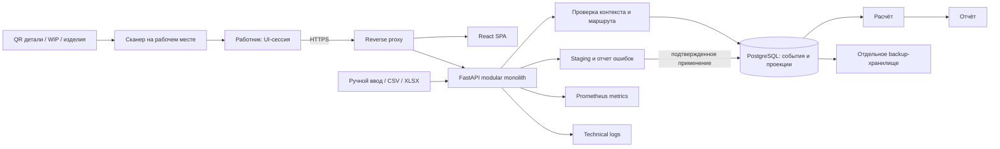
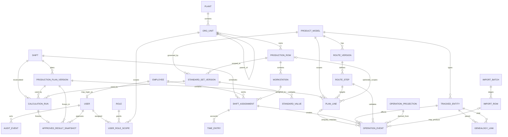

# Архитектура и план поставки

Статус: рекомендуемая базовая архитектура до discovery. Дата проверки технологических источников: 25 октября 2026 года.

## 1. Цель и границы

Нужно создать многопользовательское веб-приложение производственного учета и расчета КПД изготовления квадрокоптеров. Первый пилот охватывает пять рядов: три сборочных, один пайки и один ОТК. Для производства рассматриваются компоненты «выполнение плана / качество с первого предъявления / производительность»; работа ОТК оценивается отдельными показателями охвата, своевременности и корректности решений на независимой перепроверке. Точная методика еще должна быть согласована. Система должна быть убедительной как портфолио и иметь путь к реальной локальной эксплуатации на заводе. Точные нормы, формулы, источники, объемы, оргструктура и требования ИБ пока не предоставлены, поэтому их нельзя незаметно зашить в код или объявить согласованными.

До промышленной эксплуатации обязателен discovery с владельцем процесса, технологом, ОТК, ИТ/ИБ и будущими пользователями. Ни демонстрационная формула, ни синтетические показатели не являются доказательством экономического эффекта. Эффект можно заявлять только после согласованной базы сравнения и измерений на пилоте.

### Допущения для планирования

- Начальный масштаб MVP — одна заводская площадка и пять рядов (три сборки, пайка, ОТК), десятки одновременных пользователей, а не глобальная MES. Иерархия данных допускает будущее расширение, но оно не входит в пилот.
- Первичный факт выполнения операции появляется после сканирования QR работником на своем компьютере/планшете с подключенным сканером. Ручной ввод и согласованный CSV/XLSX-контракт дополняют QR-события для планов, норм, назначений и корректировок.
- Автоматическое получение данных из MES/1С не обещается до изучения конкретных систем, их API, ответственности и качества данных.
- Сеть завода может быть изолированной или иметь нестабильный доступ в интернет; рабочий контур не должен зависеть от внешнего облака.
- Первичная единица учета — неизменяемое событие операции над типизированной сущностью: деталь, временная сборочная единица/WIP или готовый квадрокоптер. Смена и показатели рядов — производные проекции.
- У деталей собственные QR; для сборки предлагается временный WIP QR, позднее связываемый с QR/серийным номером готового квадрокоптера. Необходимость и момент печати WIP QR подтверждаются на discovery.
- Персонал назначается на ряды ежедневно; на каждом ряду есть бригадир. Фактические назначения и рабочие часы ведутся отдельно от межскановых интервалов.
- MVP поддерживает одну модель квадрокоптера, все предусмотренные роли и настраиваемый маршрут в контексте пяти рядов. Нельзя заранее утверждать, что один экземпляр последовательно проходит все три сборочных ряда: они могут выполнять параллельные ветви или разные операции.
- Русский язык и часовой пояс завода обязательны; хранение времени — UTC плюс явная локальная зона и календарь смен.
- Подпись смены здесь означает прикладное утверждение с идентификацией пользователя и аудитом, но не квалифицированную электронную подпись. Юридические требования проверяются отдельно.
- Оценки ниже даны в человеко-днях опытной кросс-функциональной команды и не являются календарным обещанием.

## 2. Рекомендуемый стек

Один рекомендуемый вариант:

| Слой | Выбор | Почему |
|---|---|---|
| Backend | Поддерживаемая версия Python, FastAPI, Pydantic | Быстрая разработка типизированного API; FastAPI публикует OpenAPI/JSON Schema и поддерживает стандартные механизмы безопасности. |
| Доступ к данным | Стабильная совместимая ветка SQLAlchemy, Alembic | Явные транзакции и ORM; Alembic — штатный инструмент миграций для SQLAlchemy. |
| База данных | Поддерживаемая стабильная версия PostgreSQL | Транзакции, ограничения, `numeric`, блокировки строк, надежное резервное копирование и PITR. |
| Frontend | React, TypeScript в strict mode, Vite | Компонентный UI, статическая проверка типов, простой SPA build без ненужного SSR. |
| Контракт | OpenAPI 3.1 от backend; сгенерированный TypeScript-клиент | Один источник истины для DTO; CI проверяет, что сгенерированный клиент и схема не устарели. |
| Импорт | CSV стандартной библиотекой; XLSX через `openpyxl` на этапе импорта | Сначала безопасный поток staging/валидации; библиотека и ограничения файла пинуются после прототипа на реальных шаблонах. |
| Тесты | pytest, интеграционные тесты с PostgreSQL, frontend unit/component tests, Playwright для критических сценариев | Покрытие доменной математики, транзакций и пользовательских путей. |
| Поставка | OCI-контейнеры, Docker Compose на одном локальном Linux-сервере/VM, reverse proxy с TLS | Реалистичный и обслуживаемый старт для одного завода; Kubernetes на исходном масштабе не оправдан. |
| Наблюдаемость | структурированные JSON-логи, Prometheus-метрики, Grafana/Alertmanager при наличии инфраструктуры | Разделение аудита бизнес-действий, технических логов и числовых метрик. |

Точные patch-версии не следует копировать из этого плана навсегда. Перед началом реализации выполняется короткий compatibility spike, затем версии фиксируются lock-файлами и digest контейнеров; обновления проходят тестовый контур. Асинхронный SQLAlchemy допустим, но не является самоцелью: для умеренной нагрузки синхронный стек проще. Решение принимается по профилю запросов; сессия БД никогда не разделяется между конкурентными задачами.

### Проверенные официальные основания

- [FastAPI: OpenAPI, JSON Schema, валидация и security schemes](https://fastapi.tiangolo.com/features/).
- [SQLAlchemy: asyncio для Core и ORM и ограничения AsyncSession](https://docs.sqlalchemy.org/en/latest/orm/extensions/asyncio.html).
- [Alembic: миграции SQLAlchemy, autogenerate и offline SQL](https://alembic.sqlalchemy.org/en/latest/).
- [PostgreSQL: уровни изоляции, конкурентные изменения и необходимость retry](https://www.postgresql.org/docs/current/transaction-iso.html).
- [React: официальное использование TypeScript](https://react.dev/learn/typescript).
- [TypeScript Handbook: статическая проверка типов](https://www.typescriptlang.org/docs/handbook/intro).
- [Vite: официальный React/TypeScript preset и compatibility requirements](https://vite.dev/guide/).
- [Docker Compose для production на одном сервере](https://docs.docker.com/compose/how-tos/production/).
- [Prometheus: модель метрик и alerting](https://prometheus.io/docs/introduction/overview/).
- [OWASP: хранение паролей](https://cheatsheetseries.owasp.org/cheatsheets/Password_Storage_Cheat_Sheet.html) и [управление сессиями](https://cheatsheetseries.owasp.org/cheatsheets/Session_Management_Cheat_Sheet.html).

## 3. Архитектурный стиль

### Модульный монолит

Первый промышленно применимый релиз — один backend deployable, один frontend и одна PostgreSQL. Внутри backend модули имеют явные границы:

1. `identity_access` — пользователи, группы, роли, области доступа, сессии;
2. `organization` — заводы, цеха, участки, линии, рабочие центры;
3. `catalog` — модели квадрокоптеров, типы деталей/сборочных единиц, операции, единицы измерения, сменные календари;
4. `standards` — версии норм и формул, сроки действия, согласование;
5. `routing` — версионированные маршруты, шаги, допустимые переходы и типы сущностей;
6. `execution` — append-only журнал QR-событий операций и изменяемые проекции текущего состояния;
7. `genealogy` — связь деталь → WIP → готовый серийный номер, bind/unbind и история замен;
8. `workforce` — смены, ежедневные назначения работник/ряд/станция/операция и версионируемый ledger фактических часов по категориям;
9. `quality` — проверки ОТК, дефекты, принятые/отбракованные количества и разрешенный rework;
10. `imports` — загрузка, staging, валидация, применение и происхождение данных;
11. `calculation` — серверный расчет компонентов и итогов;
12. `approval` — проверка, утверждение, переоткрытие по регламенту;
13. `reporting` — выборки и выгрузки из утвержденных снимков;
14. `audit` — неизменяемый прикладной журнал действий пользователя.

Модули общаются через сервисный слой и доменные типы, а не напрямую через чужие таблицы. Сначала нет брокера сообщений, микросервисов, data lake и Kubernetes. Внутренние события можно сохранять через transactional outbox, только если появятся надежные внешние интеграции.

### Поток данных

## 4. Типизированный API и правила вычислений

- Backend владеет OpenAPI-схемой. TypeScript-типы и клиент генерируются из нее; ручные дубли DTO запрещены.
- Версионирование API — `/api/v1`; несовместимое изменение требует новой версии либо миграционного периода.
- Ошибки имеют стабильный код, человекочитаемое сообщение, `trace_id` и структурированный список полей; внутренние детали не выдаются.
- Все авторитетные расчеты выполняются сервером. Клиент может показывать предварительный preview, но не сохраняет собственный итог.
- Формула не задается произвольным исполняемым Python/SQL из UI. Допустим белый список операторов и именованных компонент либо кодовая стратегия с `formula_version` и тестовыми эталонами.

До согласования формулы система хранит отдельно исходные величины: план, уникальные завершения нормативных операций, first-pass good, rework, брак, нормативное время, фактические назначения/часы, простои и контекст единиц. Деталь или промежуточная сборочная единица не считается готовым изделием: finished output возникает только на согласованном завершающем шаге сущности типа `final_product`.

Рабочая гипотеза для обсуждения, а не утвержденная методика: `s_i` — норматив строки плана в человеко-минутах; `E_fact` — сумма нормо-часов уникальных первичных завершений операций; `E_plan` — план по фиксированным строкам модели/операции/ряда; `E_plan_covered = Σ[min(q_fact_i,q_plan_i)×s_i]/60` в нормо-часах. `A_volume = E_fact/E_plan` показывает сырой объём, а `A_plan = E_plan_covered/E_plan` — покрытие номенклатурного плана без компенсации дефицита одной строки сверхпланом другой. `E_quality_eligible` — сопоставимая сумма нормо-часов созревшей когорты, подлежащей оценке первого предъявления; `E_first_pass_good` — её часть, принятая с первой попытки. Производительность `P = E_fact/(H_accounted×rho_target)`, качество `Q = E_first_pass_good/E_quality_eligible`, возможный производственный итог `100×min(A_plan,P,1)×Q` при полном наборе знаменателей и пройденном quality gate. `H_accounted` — фактически потреблённый трудовой ресурс по версионируемой методике, включая rework и другие утверждённые категории; он берётся из ledger табеля/назначений, а не из времени между сканами. Эту гипотезу нельзя реализовывать как production-правило до подтверждения владельцами сборки, пайки и ОТК, определения контуров, `rho_target`, `Q_min`, окна созревания и golden examples. Найденный инспектором дефект не штрафует ОТК: пропуски и ложные отклонения ОТК определяются только на независимой аудиторской выборке и не смешиваются с производственным `Q`.

Для отдельного контура ОТК `s_otk_i` также задаётся в человеко-минутах: `E_otk_fact=Σ[fact_i×s_otk_i]/60`, `E_otk_plan=Σ[plan_i×s_otk_i]/60`, `E_otk_plan_covered=Σ[min(fact_i,plan_i)×s_otk_i]/60`; все три величины измеряются в нормо-часах. Если норма хранится сразу в нормо-часах, деление на 60 не применяется, а единица фиксируется в версии нормы и не смешивается внутри расчёта.

### Точность и граничные случаи

- Штучные количества — целые неотрицательные значения (`bigint` при необходимости); продолжительность — целое число секунд или минут с явной единицей.
- Нормы, коэффициенты и результаты — `numeric/Decimal`, например `numeric(18,8)`. IEEE float не используется для авторитетной математики.
- Промежуточные значения не округляются; правило округления и количество знаков входят в версию формулы. UI округляет только отображение.
- Для каждой метрики задаются единица, допустимый диапазон, политика нуля и верхней границы. Значение выше 100% не обрезается молча: оно либо допустимо и показывается, либо становится ошибкой согласно согласованному правилу.
- Деление на ноль дает статус `not_calculable`, а не 0 и не бесконечность.
- Неполные данные дают `draft/incomplete` с перечнем отсутствующих полей. Такой расчет нельзя утвердить, если обязательность не отменена конкретным правилом.
- Отрицательные значения, несовместимые единицы, пересекающиеся назначения и физически невозможные переходы проверяются сервером. Сравнение ОТК и выпуска допустимо только в одной определенной когорте, для сопоставимых типов операций и с учетом WIP/повторных проверок; простое правило «ОТК не больше выпуска смены» не универсально. Часть проверок — error, часть — warning с обязательным комментарием; классификация согласуется на discovery.
- Тестовые «золотые» примеры формулы подписывают технолог и ОТК; property-based tests проверяют инварианты и границы.

## 5. Данные, версии норм и снимки

Ключевые правила модели:

- Все бизнес-идентификаторы — UUID; внешние ключи источников хранятся отдельно.
- `PRODUCTION_PLAN_VERSION` относится к смене/периоду и имеет статусы `draft/approved/superseded`; утверждённая версия неизменяема. `PLAN_LINE` фиксирует модель, route step/операцию, плановое количество, `s_i` и необязательный ряд. Корректировка создаёт новую версию плана со ссылкой `supersedes`, причиной и повторным утверждением.
- Расчёт фиксирует использованную `plan_version_id` и однозначное сопоставление каждого учитываемого факта максимум одной `PLAN_LINE` этой версии. Один `OPERATION_EVENT` не может покрывать две строки одного плана; согласованная замена позиции задаётся правилом версии плана, а не двойным назначением. Mapping и plan version входят в `CALCULATION_RUN`/`APPROVED_RESULT_SNAPSHOT`, поэтому история воспроизводима.
- `OPERATION_EVENT` — append-only источник факта: `event_id`, тип события, сущность и ее тип, версия маршрута/шаг, номер попытки, assignment, рабочее место, ряд, `occurred_at_device` при наличии, авторитетный `received_at_server`, idempotency key и ссылка на отменяющее/замещающее событие. Ошибку исправляют компенсирующим событием, не `UPDATE` прошлого.
- Техническая idempotency гарантирует уникальность `event_id`/client request id. Семантическая защита от двойного скана использует уникальность вида `(entity_id, route_version_id, route_step_id, attempt_no, completion_kind)`; новую попытку/rework открывает только разрешенное серверное действие.
- `OPERATION_PROJECTION` и текущий статус маршрута изменяемы и могут быть пересобраны из журнала. Отчеты и UI читают проекции, но аудит/перерасчет опираются на события.
- Событие проходит только разрешенный route transition для типа сущности. Операция над `component` или `wip` не увеличивает finished units. Версия маршрута закрепляется при запуске экземпляра, чтобы публикация нового маршрута не переписала историю.
- `GENEALOGY_LINK` в MVP хранит сериализованные `attach`, `detach`, `replace`, `scrap`, связь rework и WIP→final serial с количеством, статусом, временем действия, причиной и source event. Частичный уникальный индекс/транзакционная блокировка запрещает одной активной физической детали одновременно принадлежать двум сборочным единицам. Замена сохраняет обе связи и историю, а не перепривязывает строку задним числом. Партийные `split/merge` остаются после MVP.
- Финальный QR/serial связывается с существующим WIP без потери lineage; конкретная модель идентичности (`alias` той же сущности или отдельный `final_product` с transition) выбирается после проверки процесса печати этикеток.
- `SHIFT_ASSIGNMENT` фиксирует сотрудника, ряд, workstation, разрешённую операцию и интервал назначения. `TIME_ENTRY` отдельно хранит интервалы/количество человеко-часов по категориям `primary`, `rework`, `waiting`, `setup`, `support`, `unavailable`, источник, статус подтверждения, версию и ссылку correction/supersedes. Именно утверждённые записи ledger формируют `H_accounted`; межскановые интервалы его не изменяют. UI-сессия связывает `worker + workstation + row + operation + shift`; HID-сканер сам по себе не идентифицирует сотрудника или устройство.
- `STANDARD_SET_VERSION` неизменяема после публикации, имеет `effective_from`, `effective_to`, область применения, единицы, формулу/версию округления, автора и согласовавшего. Интервалы одной области не пересекаются.
- Исправление опубликованной нормы создает новую версию. Норма для смены выбирается по согласованному событию (обычно начало смены), а не по текущей дате расчета.
- `CALCULATION_RUN` хранит входной hash, версию алгоритма, версию норм, компоненты, итог, статусы качества данных и подробный trace без персональных секретов.
- Статус утверждения смены и зрелость метрики — независимые оси. Для результата хранятся `approval_status` и `maturity_state` (`PROVISIONAL`, `AWAITING_AUDIT`, `FINAL`), а также отдельные reason flags, включая `INCOMPLETE_DATA` и `QUALITY_GATE_FAILED`. Утверждённая смена не превращает незрелый Q или KPI в официальный.
- `APPROVED_RESULT_SNAPSHOT` — неизменяемый снимок использованных исходных значений и результатов. Последующая смена норм не меняет историческое утвержденное значение.
- Переоткрытие не перезаписывает снимок: фиксируются причина, кто разрешил, новый расчет и связь `supersedes` с предыдущим снимком.
- Удаление значимых бизнес-данных физически не выполняется из UI; используется статус аннулирования с причиной и аудитом. Политика retention согласуется с заводом.
- Ограничения целостности, уникальные индексы и CHECK constraints дублируют критичные прикладные проверки.

## 6. Доступ, аутентификация и аудит

### RBAC и область доступа

Роль отвечает на вопрос «что можно делать», scope — «где можно делать». Scope иерархический: завод → цех → участок → линия; доступ к родителю может наследоваться вниз по явно заданному правилу.

| Роль | Основные права | Типичный scope |
|---|---|---|
| Системный администратор | пользователи, роли, конфигурация; без права менять производственные факты по умолчанию | завод |
| Владелец справочников/норм | проекты и публикация норм по принципу двух лиц | завод/цех/линия |
| Работник ряда | сканирование разрешенной операции в активной сессии; просмотр своего контекста | назначенный ряд/операция/смена |
| Бригадир | назначения на ряд, разбор дублей/ошибок, запрос rework/замены в пределах полномочий | свой ряд |
| Инспектор ОТК | события проверки, решение качества и направление на согласованный rework | ряд ОТК |
| Утверждающий смену | проверка полноты и утверждение; переоткрытие отдельным разрешением | цех/линия |
| Аналитик/аудитор | чтение результатов, происхождения и журнала | заданная область |
| Наблюдатель | только агрегированное чтение | заданная область |

Проверка прав выполняется на backend для каждого объекта; скрытие кнопки на frontend не является контролем доступа. Для критических действий рекомендуется separation of duties: автор нормы не публикует ее единолично; пользователь не утверждает собственную смену, если завод не утвердил исключение.

### Аутентификация

Предпочтение — интеграция с заводским IdP через OIDC (или согласованный корпоративный шлюз AD/LDAP), если он есть. Это решается на discovery. Для автономного пилота допустима локальная аутентификация:

- пароль хранится только как Argon2id hash с индивидуальной salt;
- серверная сессия с непрозрачным случайным идентификатором в `HttpOnly`, `Secure`, `SameSite` cookie; токены не хранятся в `localStorage`;
- CSRF-защита для изменяющих запросов, TLS, rate limiting входа, блокировка/задержка по политике ИБ;
- idle и absolute timeout, принудительный отзыв сессий, обновление идентификатора при входе и изменении привилегий;
- MFA для администраторов/утверждающих — по требованиям ИБ и возможностям IdP;
- bootstrap-admin создается процедурой развертывания и обязан сменить секрет; сервисные учетные записи не могут входить в UI.

### Журнал аудита

Отдельная append-only таблица содержит: UTC-время, actor/user, session correlation hash, действие, тип и id объекта, scope, before/after diff с маскированием, причина, request/trace id, import batch, IP/agent согласно политике. Аудируются входы, неуспешные попытки, изменение прав, норм, фактов, импорты, расчет, утверждение, переоткрытие, выгрузки и административные операции. Аудит пишется в той же транзакции, что и бизнес-изменение; обычные пользователи и администратор приложения не могут его редактировать. Технические логи не заменяют аудит.

## 7. Конкурентное редактирование и атомарное утверждение

QR completion — это команда создать событие, а не редактирование счетчика. Сервер проверяет активную UI-сессию `worker + workstation + row + operation + shift`, назначение работника, тип QR, закрепленную версию маршрута, допустимый переход, попытку/rework и semantic duplicate. `received_at_server` определяет авторитетный порядок; часы устройства сохраняются лишь как диагностическое поле с признаком расхождения. Нельзя выводить личность работника из USB/HID-сканера: идентификация идет через вход пользователя и серверное назначение workstation.

Для справочников, назначений, маршрутов и других изменяемых черновиков применяется optimistic concurrency: у записи есть `version`/`updated_at`, клиент отправляет `If-Match`. При чужом изменении backend отвечает `409 Conflict` с текущей версией и diff; молчаливого last-write-wins нет. Применение QR-события и обновление его проекции атомарны; при сбое проекция может быть детерминированно пересобрана.

MVP — online-first: сервер подтверждает каждую операцию до продвижения маршрута. Перед отправкой клиент создает UUID и надежно сохраняет ровно один `pending scan`, связанный с исходными worker/workstation/row/operation/shift. Пока нет однозначного ответа, UI блокирует новые сканы и показывает восстановимое состояние. После связи клиент делает status lookup и/или retry с тем же UUID; уникальность события делает повтор безопасным. Pending переживает перезагрузку, выход/смену работника и не может быть присвоен другому: исходный работник завершает после повторной аутентификации либо бригадир выполняет отдельное аудируемое разрешение/отмену. Маршрут и счетчики меняются только после server acknowledgement.

Полноценная offline-очередь нескольких сканов, локальное продвижение маршрута и разрешение конфликтов вне MVP. Если обследование сети покажет, что online-first непригоден, scope, сроки и threat model пересматриваются до реализации, а не компенсируются скрытой очередью.

Утверждение смены выполняется одной короткой транзакцией:

1. заблокировать строку смены `SELECT ... FOR UPDATE`;
2. убедиться, что статус еще `draft/review`, версия совпадает, а у пользователя есть право и scope;
3. проверить отсутствие незавершённого импорта, неразобранных pending/duplicate/rework событий, нарушений genealogy, неполного time ledger и обязательных ошибок;
4. выбрать применимую опубликованную версию норм;
5. зафиксировать верхнюю границу журнала событий, прочитать согласованный набор событий/назначений и пересобранные проекции, вычислить canonical input hash и результат сервером;
6. создать неизменяемые `CALCULATION_RUN` и `APPROVED_RESULT_SNAPSHOT`;
7. перевести смену в `approved`, но сохранить независимые maturity/reason flags расчёта; записать аудит;
8. commit всех изменений вместе либо полный rollback.

Уникальное ограничение запрещает два активных утвержденных снимка одной смены. При сериализационном конфликте backend делает ограниченное число безопасных retry, затем возвращает конфликт. После утверждения закрывается прием обычных событий в эту смену. Ошибка исправляется компенсирующим событием через регламентированное переоткрытие с причиной и новой цепочкой снимков; прошлое событие физически не переписывается.

## 8. Импорт CSV/XLSX как отдельный этап

Импорт не должен быть прямым `INSERT` в производственные таблицы. Pipeline:

1. прием файла с лимитом размера/строк, проверкой MIME/расширения, безопасным именем и SHA-256;
2. запись `IMPORT_BATCH` со статусом и происхождением; файл помещается в карантинное хранилище с ограниченным доступом и сроком retention;
3. выбор версионированного mapping profile: лист, заголовки, локаль чисел/дат, часовой пояс, единицы;
4. потоковый parse в staging без исполнения формул, макросов и внешних ссылок;
5. построчная и пакетная валидация со стабильными кодами ошибок;
6. preview: принято/предупреждения/ошибки/дубли и скачиваемый отчет;
7. явное применение валидной части или политика «весь пакет целиком» — выбор фиксируется для конкретного типа импорта;
8. транзакционное преобразование staging → доменные команды/события или справочники и аудит.

Idempotency задается уникальным ключом источника: `(source_system, source_dataset, external_row_id, source_revision)`; если надежного row id нет — canonical row hash плюс идентификатор бизнес-ключа. Повтор файла с тем же SHA-256 возвращает предыдущий результат и не создает факты повторно. Исправленный файл создает новый batch и `supersedes`; он не меняет утвержденную смену без переоткрытия. Сырые строки и ошибки связаны с batch для трассировки.

CSV/XLSX реализуется после получения 3–5 реальных обезличенных файлов каждого вида. На discovery проверяются объединенные ячейки, формулы, скрытые листы, локальные разделители, ведущие нули, дубликаты, большие файлы и защита от CSV injection в экспортируемых отчетах. Импорт плана/норм/назначений не подменяет QR-журнал исполнения. Массовый импорт исторических completion events разрешается только отдельным контрактом с теми же route/idempotency/genealogy-проверками.

## 9. Локальная инфраструктура завода

Минимальный production-контур для одного завода:

- выделенная Linux VM/сервер в серверном сегменте; рабочие места заходят только через HTTPS reverse proxy;
- контейнеры frontend/reverse proxy, API и PostgreSQL с health checks, restart policy и лимитами ресурсов; БД не публикуется в пользовательскую сеть;
- persistent volumes на надежном диске; backup-копии — на физически отдельном хранилище/сервере, не только рядом с VM;
- внутренний DNS и сертификат заводского PKI либо согласованного CA; синхронизация времени с заводским NTP;
- secrets вне Git и образов, с правами ОС и процедурой ротации;
- отдельные dev/test/pilot/prod конфигурации и БД; production-данные не копируются в портфолио или dev без формальной деперсонализации;
- outbound internet не требуется для работы. Образы и пакеты доставляются через утвержденный внутренний registry/репозиторий или подписанный offline bundle;
- migration runbook: backup, проверка Alembic head, миграция, smoke-test, наблюдение и документированный rollback/forward-fix.

Compose на одном узле не дает высокой доступности. Если discovery потребует строгий SLA, безостановочное обновление или работу при падении узла, отдельно проектируются реплика PostgreSQL, failover, балансировка и эксплуатационная ответственность — это не «бесплатная галочка» текущего решения.

### Backup и восстановление

RPO/RTO сначала согласуются. Стартовая гипотеза для пилота: RPO ≤ 24 ч и RTO ≤ 8 ч; для реального сменного контура это может быть недостаточно.

- ежедневный зашифрованный `pg_dump` custom format с retention (например, 14 ежедневных, 8 недельных, 12 месячных — только после согласования);
- для меньшего RPO — регулярный base backup плюс непрерывный WAL archive/PITR; [официальная документация PostgreSQL описывает этот механизм](https://www.postgresql.org/docs/current/continuous-archiving.html);
- отдельно сохраняются конфигурация, manifests образов, secrets по корпоративной процедуре и загруженные исходные файлы, если они входят в retention;
- автоматическая проверка завершения backup, размера, checksum и возраста последней успешной копии;
- restore drill в изолированную среду минимум ежеквартально и перед опасными миграциями; backup без проверенного восстановления не считается рабочим;
- runbook фиксирует владельца, порядок восстановления, проверку целостности, переключение DNS и коммуникацию.

### Наблюдаемость

- Метрики RED: rate, errors, duration API; DB pool/locks/slow queries; import queue/duration/rejected rows; calculation and approval failures; возраст backup; диск/CPU/RAM.
- Алерты только на действия: сервис недоступен, рост 5xx, исчерпание диска, долгие блокировки, backup просрочен/упал, импорт застрял, часы расходятся.
- Структурированные логи содержат `trace_id`, но не пароль, session token, содержимое файлов и лишние персональные данные. Retention и доступ согласуются с ИБ.
- Проверка готовности отличается от liveness; readiness учитывает БД и примененную схему.
- Бизнес-метрики КПД не хранятся только в Prometheus: источником истины остается PostgreSQL и утвержденные снимки.

## 10. Стратегия тестирования и качества

| Уровень | Что проверяет |
|---|---|
| Unit | формулы Decimal, диапазоны, выбор норм по времени/scope, RBAC predicates, parsing полей |
| Property-based | инварианты, монотонность там, где она согласована, нули, экстремумы, округление |
| Contract | OpenAPI snapshot, совместимость с генерируемым TS-клиентом, стабильные ошибки |
| DB integration | PostgreSQL constraints, миграции up/down где безопасно, locking, active genealogy uniqueness, time ledger versions, optimistic concurrency, idempotent import |
| Event/projection | повтор `event_id`, semantic duplicate, route transitions, rework attempts, compensating events, полная пересборка проекций |
| Method state | approval смены не меняет `PROVISIONAL/AWAITING_AUDIT/FINAL`; reason flags и независимый audit ОТК корректно блокируют official KPI |
| Time accounting | `H_accounted` собирается из утверждённых `TIME_ENTRY` и категорий методики; добавление/удаление межскановых событий не меняет часы |
| Transaction/concurrency | одновременные сканы/bind одной детали, редактирование и утверждение, retry, единственный snapshot, rollback аудита вместе с действием |
| Import fixtures | реальные обезличенные и синтетические CSV/XLSX, локали, дубли, поврежденные и большие файлы |
| Frontend/component | scan-focused формы, доступность с клавиатуры, явное подтверждение QR, ошибки, статусы delivered/incomplete/conflict |
| Hardware/browser | каждый согласованный scanner + workstation/browser, раскладка/суффикс ввода, двойной скан, потеря фокуса, нестабильная сеть; HID не считается identity |
| E2E | ввод данных/скан → проверка маршрута и genealogy → расчет → отчет; bind/replacement, ОТК/rework, запрет действий вне scope |
| Security | dependency/container scan, secret scan, CSRF/XSS/IDOR, rate limit, матрица RBAC, backup access |
| Performance | согласованный объем строк/файлов и конкуренции; p95 API/import/approval с запасом |
| Recovery | восстановление backup и запуск smoke suite |

Definition of Done для каждого изменения: миграция и rollback-план, тесты, audit/security impact, документация API и операционный impact. Критическая доменная математика требует независимого review и эталонных примеров владельца процесса.

## 11. Дорожная карта

Оценка: 1 человеко-день = 6–7 часов сфокусированной работы. Диапазоны включают разработку, review, тесты и документацию, но не закупку оборудования, ожидание доступов и календарное ожидание согласований. Параллельность сокращает календарь только там, где сняты зависимости. AI может ускорить подготовку артефактов и рутинный код, но не заменяет наблюдение процесса, решение владельца данных, ИБ-аудит, UAT и физические испытания.

| Этап | Зависит от | Результат и подэтапы | Приемка | Оценка, чел.-дн. |
|---|---|---|---|---:|
| **1. Методика** | доступ к сборке, пайке, ОТК, технологу, ИТ/ИБ | Обязательный discovery; карта пяти рядов без предположения об их последовательности; виды QR и момент появления WIP/final; маршруты/переходы/rework/genealogy; кадровые назначения и часы; формулы-кандидаты для трех категорий; источники плана/норм; scanner/network spike; NFR, RPO/RTO и критерии пилота | подписаны словарь, границы MVP, route/genealogy rules, formula golden examples, источники истины и критерии успеха; у открытых вопросов есть владельцы | 16–25 |
| **2. Основа системы** | 1 | Compatibility spikes; ADR/threat model; repo/CI/migrations; OpenAPI contract; dev/test Compose; auth, RBAC/scopes; оргструктура из пяти рядов, workstation registry; product/entity types; versioned route skeleton; telemetry foundation | чистое развертывание по инструкции; matrix RBAC/IDOR проходит; versions locked; один synthetic route валидируется; schema/client drift ловит CI | 17–27 |
| **3. Учёт смен** | 1–2, реальные сканеры и обезличенные примеры | Смены и ежедневные assignments; TIME_ENTRY ledger категорий часов; UI-сессия worker/workstation/row/operation/shift; QR event journal; один durable pending scan и retry/status с тем же UUID; idempotency и semantic duplicates; mutable projections; component→WIP→final genealogy, attach/detach/replace/scrap/rework; ОТК; согласованный CSV import | повторный/двойной скан не дублирует; при потере ответа новые сканы заблокированы, pending переживает reload/смену пользователя и не меняет автора; запрещены неверный переход и активная деталь в двух изделиях; часы не выводятся из сканов; replacement history воспроизводима; projection rebuild совпадает | 23–38 |
| **4. Расчёт КПД** | утверждённая методика 1, события/назначения/ledger 3 | Versioned norms/formulas для сборки, пайки и ОТК; A_volume/A_plan, H_accounted, E_quality_eligible; независимый audit ОТК; Decimal calculation; отдельные approval/maturity/reason axes; atomic approval; snapshots/reopen | golden tests совпадают; сверхплан одной строки не закрывает дефицит другой; детали/WIP не считаются finished units; rework и ledger учитываются по методике; смещённая выборка ОТК даёт NULL; approval не подменяет maturity; история воспроизводима | 14–23 |
| **5. Отчёты** | 3–4 | Поток «Ввод данных → Проверка → Расчёт → Отчёт»; dashboard по смене/ряду/категории; drill-down до события, назначения, нормы и genealogy; безопасный export; audit viewer | значение объясняется до первичных событий; выгрузка совпадает со snapshot; ограничения scope соблюдены; основные пути доступны с клавиатуры | 8–14 |
| **6. Пилот** | 1–5, готовность завода | TLS/secrets, backup/restore, мониторинг, security/performance tests и runbooks; интеграция компьютеров/планшетов и сканеров; обучение; параллельный прогон одной модели на пяти рядах; журнал расхождений и go/no-go. Здесь же портфолио: synthetic seed, README, ADR, тестовый отчет, demo/video без реальных данных | restore drill и алерты проверены; целевые p95/RPO/RTO приняты; согласованное число смен сверено с текущим процессом; все роли и настраиваемый маршрут испытаны; новый проверяющий запускает demo; промышленный rollout разрешен отдельным решением | 18–32 плюс календарное наблюдение |

Итого без внешнего календарного ожидания: примерно **96–159 человеко-дней**. Это ROM-оценка до discovery с погрешностью порядка −25%/+50%. После этапа 1 команда пересчитывает backlog и дает отдельные оценки MVP, пилота и промышленного ввода.

### Контрольные ворота

- После этапа 1: не продолжать доменную реализацию без письменного решения по маршрутам, genealogy, правилам QR, формулам и источникам истины.
- После spikes: заменить стек только на основании измеренного incompatibility/operational risk и оформить ADR.
- Перед пилотом: threat model, backup restore, матрица RBAC, миграционный и incident runbook обязательны.
- Перед production: UAT, владелец эксплуатации, обучение, RPO/RTO и процедура поддержки формально приняты.
- После пилота: публиковать заявления об улучшении качества/КПД только с методикой, периодом и исходными измерениями.

## 12. Портфолио и защита реальных данных

- `demo` использует детерминированные синтетические данные с заметной маркировкой; они не должны быть псевдонимизированной копией реальных смен.
- Реальные схемы файлов документируются обезличенными минимальными примерами либо контрактом полей. Реальные названия сотрудников, серийники, дефекты и показатели не входят в публичный Git, скриншоты или видео.
- README объясняет задачу, ограничения, архитектуру, быстрый запуск demo, тесты, security model и различие demo/production.
- ADR фиксируют как минимум: модульный монолит, PostgreSQL/Decimal, версия норм и snapshots, optimistic locking, импорт через staging, auth strategy, single-node Compose и условия перехода к HA.
- В репозитории должны быть архитектурные диаграммы, OpenAPI, миграции, unit/integration/E2E tests, synthetic seed и отчет о проверенном restore.
- Видео 3–5 минут показывает: роль и scope, component/WIP/final QR, разрешенный маршрут и блокировку дубля, замену детали с историей, событие ОТК/rework, серверный расчет, утверждение, audit trail и воспроизводимость исторического результата после новой нормы.
- Кейсовое описание формулирует «что построено и как проверено», а не «на сколько вырос КПД», пока пилот не дал измерения относительно согласованной базы.

## 13. Вопросы, обязательные к закрытию на discovery

1. Какие операции относятся к трем сборочным рядам, пайке и ОТК; это последовательные, альтернативные или параллельные ветви маршрута для одной модели?
2. Что именно завершает один scan: отдельную операцию, весь шаг ряда или сборку; может ли шаг требовать несколько сканов/подтверждение бригадира?
3. Как устроены сканеры и браузерный ввод (USB/HID, суффикс Enter, модель устройства), требуется ли device registration и насколько надежна сеть каждого рабочего места?
4. Что кодирует QR детали, когда создается временный WIP QR, кто печатает финальный QR/serial и может ли код переиспользоваться?
5. Какие bind/unbind/replacement разрешены, кто их подтверждает и что происходит с уже выполненными операциями после замены детали?
6. Как задаются route version, допустимые переходы, пропуск/отмена шага, rework attempt и возврат из ОТК?
7. Как завод определяет строки плана, допустимые замены и `A_plan`; качество first-pass, `H_accounted`, `rho_target`, cap, округление, период и единицы; какой независимый audit делает `Q_decision` ОТК валидным?
8. Где источник ежедневных назначений и фактических часов; как учитывать перерывы, перевод между рядами, простой, переналадку и смену операции?
9. Какая система является источником плана, табеля, норм и дефектов; какие стабильные внешние ключи доступны; что реально можно получать из MES/1С?
10. Может ли смена пересекать полночь, менять модель/норму/маршрут и включать переводы между рядами?
11. Какие проверки являются hard error, warning или разрешенным исключением; кто утверждает смену, переоткрывает ее и публикует нормы; нужен ли принцип двух лиц/ЭП?
12. Подтверждают ли замеры сети пригодность online-first на всех пяти рядах; если нет, какой пересмотр scope и требований нужен для полноценного offline вне MVP?
13. Есть ли корпоративный IdP, PKI, SIEM, registry, backup и мониторинг; разрешены ли контейнеры и Linux?
14. Каковы объем событий, одновременность, retention, SLA, окна обновления, RPO/RTO и владелец эксплуатации?
15. Какие персональные/коммерческие данные обрабатываются и какие политики ИБ, локальные нормы и требования к аудиту применимы?
16. Как выглядит измеримый успех пилота: точность событий/genealogy/расчета, скорость операции и закрытия смены, доля исключений, доступность — без заранее обещанного экономического эффекта?

