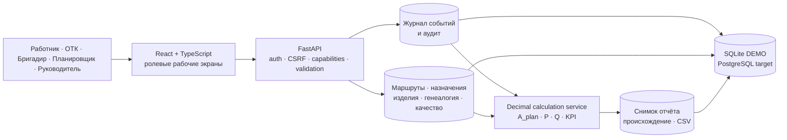

# Кейс: производственный учёт квадрокоптеров и объяснимый КПД

## Коротко

P0-Demo показывает, как связать сменные назначения, QR-события операций, генеалогию деталей и узлов, ОТК, переделки и расчёт КПД в одном локальном веб-приложении. Демо работает только на синтетических данных и не выдаётся за внедрение на заводе.


## Проблема

Для производственной сводки недостаточно сложить сканы и вывести один процент. Нужно различать детали, WIP и готовые изделия; учитывать версию маршрута и нормы; не превращать повтор сетевого запроса в повторный выпуск; отделять первичное выполнение от переделки; связывать труд с табелем, а не с интервалом между сканами; честно оценивать ОТК по независимой перепроверке решений.

Особенно легко получить убедительную, но неверную цифру: сверхплан одной операции закрывает дефицит другой, найденный инспектором дефект штрафует самого инспектора, переделка повторно зарабатывает выпуск, а отсутствие данных выглядит как 0% или 100%.

## Пользователи

| Пользователь | Что делает в демо |
|---|---|
| Работник сборки или пайки | Сканирует завершённую операцию в назначенном контексте; видит подтверждённый сервером итог и историю |
| Контролёр ОТК | Сканирует QR, выбирает «Годен/Брак», указывает DEMO-причину и проводит повторный контроль |
| Бригадир | Видит назначения и события только своего ряда, сохранённые проблемы и атрибутированные переделки |
| Планировщик | Ведёт план, назначения и человеко-часы |
| Независимый аудитор | Перепроверяет решения ОТК, не подменяя производственное качество |
| Руководитель | Смотрит сводку пяти рядов и утверждает воспроизводимый снимок результата |
| Технолог/Admin | Настраивает версию маршрута и типизированные QR в расширенном DEMO-контуре |

## Основной процесс

1. Смена получает план, назначения работников, рабочие места и опубликованную версию маршрута.
2. Работник сканирует QR после операции. Сервер проверяет пользователя, назначение, тип сущности, маршрут, управляемую попытку и дубликат.
3. Клиент хранит ровно одно неподтверждённое действие с исходным UUID до однозначного ответа; повтор запроса не создаёт второй факт.
4. ОТК атомарно сохраняет контрольную операцию и решение. Найденный дефект считается выполненной проверкой, но не признаком плохой работы контролёра.
5. Переделка открывается отдельным явным действием и учитывается отдельно от первичного выпуска. После выполнения возможен повторный контроль.
6. Расчёт использует версионированные план, нормы, человеко-часы, зрелость качества и независимый аудит; результат раскрывается до источников и может быть `NULL` с причиной.

## Архитектура



Ключевой принцип — первичный факт хранится как типизированное событие над конкретной сущностью, а сводки являются производными представлениями. Опубликованные версии маршрута не изменяются; исправления и однозначно отклонённые запросы оставляют аудиторский след.

Backend собран как модульный монолит: HTTP API, доменные сервисы и чистое Decimal-ядро расчётов разделены. Для локального P0 используется SQLite; PostgreSQL описан как целевой адаптер, но в текущей среде не проверен.

## Методика-кандидат

`A_plan` покрывает каждую фиксированную строку плана с ограничением на уровне строки, поэтому сверхплан другой позиции не скрывает дефицит. `P` сравнивает заработанные нормо-часы с версионированным `H_accounted`, включающим утверждённый потреблённый ресурс и переделки. `Q_fpy` считается только по зрелой допустимой когорте, а корректность решений ОТК оценивается отдельно по независимому аудиту.

Composite-кандидат:

```text
KPI_raw = 100 × min(A_plan, P_raw, 1) × Q_fpy
```

Это не универсальная формула и не OEE. Параметры, знаменатели, пороги и правила публикации должен утвердить владелец реального процесса. Подробности и численные golden examples находятся в [документе методики](./01-product-and-metrics.md).

## Выполненный результат P0-Demo

- Реализованы пять рядов: три сборочных, пайка и ОТК.
- Работают отдельные упрощённые экраны worker, QC и FOREMAN.
- Настраиваются черновые/опубликованные версии линейного маршрута и создаются QR компонентов/WIP/финальных изделий.
- Генеалогия восстанавливает связи компонент → WIP → финальное изделие и сохраняет историю привязок, отвязок, замен, переделок и списания.
- Реализованы идемпотентность, семантическая дедупликация, корректировки, явная переделка, независимый аудит ОТК и зафиксированный снимок отчёта.
- Метрики ряда не выдумывают качество там, где нет зрелой атрибутируемой когорты.
- Windows start/stop, persistence, SQLite backup/restore и повторный запуск проверены локально.

Фактические автоматизированные проверки на 25 октября 2026 года:

- **76 backend tests passed**;
- **16 живых Playwright-сценариев passed**;
- **12 намеренных пропусков по проекту/viewport**, **0 failed**;
- frontend typecheck, production build и npm audit — PASS.

Тот же набор был повторён в свежей изолированной локальной копии: миграции и synthetic seed на новой SQLite, backend 76 passed, `npm ci`, typecheck/build, Playwright 16 passed и 12 intentional skips без ошибок.

Это технический результат демо, а не доказательство экономического эффекта. Полный журнал доказательств: [docs/testing-status.md](./testing-status.md) и [frontend/docs/testing.md](../frontend/docs/testing.md).

[Workflow CI](../.github/workflows/ci.yml) подготовлен для ручного запуска, push в `main`/PR, backend tests, frontend typecheck/build и изолированного live E2E на мигрированной и заново засеянной SQLite. Локальный путь workflow воспроизведён; GitHub remote не подключён, публикация и hosted GitHub Actions run не выполнялись, поэтому удалённый CI PASS не заявляется.

## Что посмотреть

- [Сборка — desktop](./assets/mvp-assembly.png) и [mobile](./assets/mvp-assembly-mobile.png)
- [ОТК — desktop](./assets/mvp-qc.png), [mobile](./assets/mvp-qc-mobile.png) и [выбор DEMO-причины брака](./assets/mvp-qc-reject-reason.png)
- [Бригадир — desktop](./assets/mvp-foreman.png) и [mobile](./assets/mvp-foreman-mobile.png)
- [Сводка — desktop](./assets/mvp-dashboard.png) и [mobile](./assets/mvp-dashboard-mobile.png)
- [Инфографика продукта](./assets/kpd-production-quadcopters.png)

[Видео-демонстрация — 4:10, WebM](./assets/portfolio-demo.webm) показывает тот же локальный UI и синтетический производственный сценарий; это не запись заводского внедрения. [Сценарий, таймкоды и результаты проверки](./portfolio-demo-script.md) опубликованы рядом с кейсом.

## Ограничения и следующий gate

- Все люди, изделия, нормы, причины дефектов и показатели — синтетические.
- Реальные сканеры, сеть, маршруты, QR, нормы, табель и правила ОТК требуют обследования и UAT.
- PostgreSQL/Docker, конкурентные блокировки, нагрузка, TLS, IdP, мониторинг и промышленный backup не проверены в этой среде.
- Проверки ролей/capabilities и FOREMAN-сводка собственного ряда проверены, но полная изоляция объектов во всех прежних endpoints требует усиления до публичного доступа или пилота.
- Полная offline-очередь, MES/1С, HA, несколько площадок, граф ветвлений и партийные `split/merge` находятся вне P0.
- Пользовательское исследование с реальными работниками и измерение производственного эффекта не проводились.

Следующий честный этап — не публикация процентов, а обследование реального процесса, утверждение методики и данных, усиление защиты, репетиция PostgreSQL, проверка оборудования и параллельный пилот с заранее согласованными критериями go/no-go.
